<p align="center">
  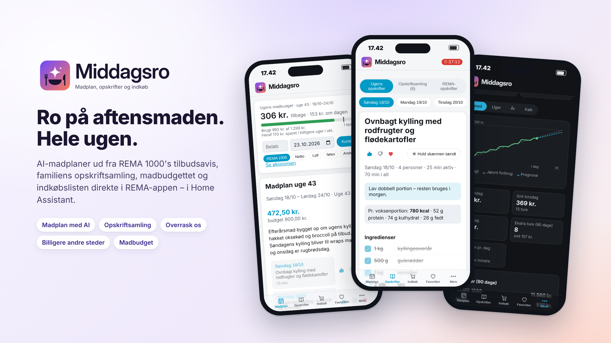
</p>

<p align="center">
  <a href="https://github.com/Dinnsen/ha-middagsro/releases"></a>
  <a href="https://github.com/Dinnsen/ha-middagsro/releases"></a>
  <a href="https://hacs.xyz"></a>
  
  
  <a href="https://github.com/Dinnsen/ha-middagsro/actions/workflows/tests.yml"></a>
  <a href="LICENSE"></a>
  <a href="https://buymeacoffee.com/dinnsen"></a>
</p>

# Middagsro – madplan og REMA 1000-indkøb i Home Assistant

🇬🇧 [Read this in English](README.md)

**Middagsro** laver ugens aftensmad med AI ud fra REMA 1000's tilbudsavis, får opskrifterne frem i køkkenet, holder styr på familiens opskriftsamling og sender indkøbslisten direkte til REMA 1000-appen med ét tryk. Din indkøbsliste i appen bliver samtidig en to-do-liste i Home Assistant, så du også kan tilføje varer med stemmen, fra en automatisering eller fra et dashboard.

> [!NOTE]
> Uofficiel integration, ikke lavet af eller tilknyttet REMA 1000 eller de andre kæder, den viser tilbud fra. REMA 1000 har ikke et offentligt API, så integrationen bruger de samme kald som rema1000.dk og webshoppen. Den kan holde op med at virke, hvis REMA ændrer deres side. Kun til personlig brug med din egen REMA 1000-konto i Danmark.

**Indhold:** [Funktioner](#funktioner) · [Krav](#krav) · [Installation](#installation) · [Opsætning](#opsætning) · [Indstillinger](#indstillinger-i-panelet) · [Entiteter](#entiteter) · [Handlinger](#handlinger) · [Eksempler](#eksempler) · [Sådan virker det](#sådan-virker-det) · [Begrænsninger](#kendte-begrænsninger) · [Fejlfinding](#fejlfinding) · [Fjern integrationen](#fjern-integrationen)

## Funktioner

Integrationen lægger et **Middagsro-panel** i sidebaren. Det følger dit Home Assistant-tema, lys og mørk tilstand, og virker lige godt på computer, tablet og telefon, hvor fanerne ligger i bunden, og man kan stryge mellem dem.

### Ugens madplan, lavet med AI

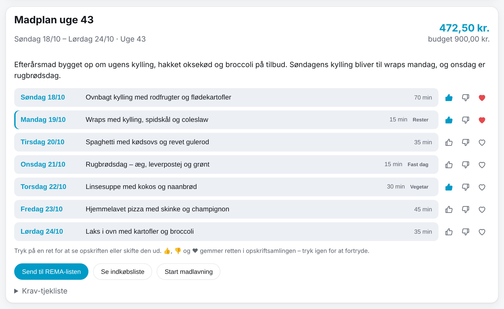

- Den AI, du har sat op i Home Assistant (en **AI-opgave**, fx Google Gemini, OpenAI eller Anthropic), laver aftensmaden for 1–14 dage og bygger retterne op om ugens tilbud.
- Planen følger jeres regler: budget, økologi, krav til æg og mælk, ting der skal undgås, allergier, antal vegetarretter, restedage, faste dage (fx rugbrødsdag), maks. tid på hverdage og jeres favoritretter.
- **Spring dage over**, hvis I ikke spiser hjemme, og vælg selv første dag.
- **Ønsker til madplanen:** skriv fx, hvad der skal bruges fra køleskabet inden en bestemt dag, eller hvilken ret I vil have en bestemt dag. Ønskerne bruges kun i den næste plan – også når den laves automatisk – og fjernes derefter.
- **Én plan for ugen:** forsiden viser hele ugen, fra familiens første ugedag til den sidste planlagte dag, som én plan – også når den er lavet i flere omgange (en ny plan fra onsdag afløser den gamle fra onsdag). Når næste uges plan er klar, kommer den under sin egen ugeoverskrift. Dage, der er gået, er nedtonet. Kalenderen og sensoren *Aftensmad i dag* følger samme regel. Opskrifter-fanen åbner altid på aftenens ret.
- **Skift, slet eller spring over:** tryk på en ret i madplanen, og få tre andre bud, slet retten eller spring dagen over. Indkøbslisten og opskriften følger med.
- **Det skal AI'en huske:** faste punkter til alle madplaner, fx “altid frisk broccoli til laksefilet” – skrevet eller dikteret.
- **Næringsmål** pr. aftensmad (kcal og fordeling af protein, kulhydrat og fedt), og fanen **Sundhed** med næring, kostrådene og mærker som Nøglehullet.
- Knapper, der bruger AI, er mærket med ✦.
- Bliver indkøbslisten **over budget**, beder integrationen AI'en om en billigere plan én gang og beholder den billigste.
- En **krav-tjekliste** viser, om planen overholder jeres regler.
- Slå **automatik** til, så laves næste uges plan, når den nye tilbudsavis udkommer – og sendes evt. direkte til REMA-listen.

### Opskrifter til køkkenet

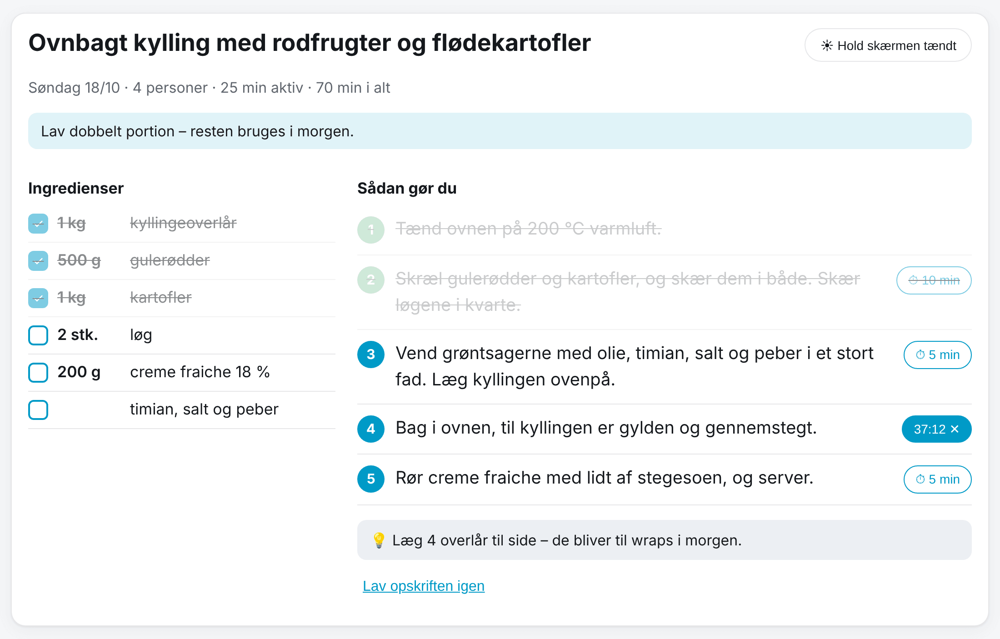

Ingredienser og trin i stor skrift. Kryds af undervejs, start en **timer** på hvert trin (den bipper og vibrerer, når tiden er gået), og tryk **Hold skærmen tændt**, mens du laver mad. Restedage henviser til den dag, maden blev lavet. Er du ikke tilfreds med en opskrift, så lav den igen.

### Den billigste indkøbsliste – direkte i REMA-appen

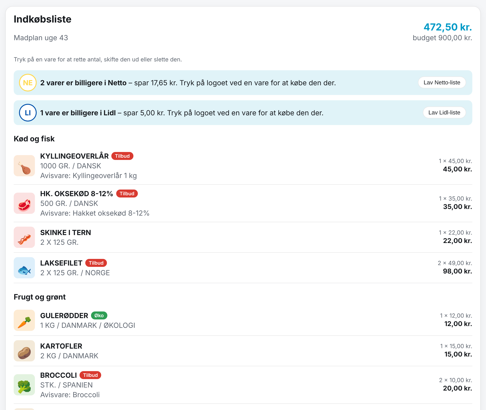

- Til hver ingrediens findes **den billigste REMA-vare**, der opfylder jeres regler. Varer fra tilbudsavisen, økologiske varer og faste ugevarer er mærket.
- Pris pr. vare, antal pakker og samlet pris mod budgettet.
- **Send til REMA-listen** lægger det hele på din primære liste i REMA 1000-appen. Varer uden et sikkert match kommer på som tekst. Sendte varer forsvinder fra Middagsro's kurv, så næste gang sendes kun det, der er kommet til siden – intet havner to gange i appen. **Genskab seneste kurv** lægger de sidst sendte varer tilbage, hvis noget gik galt.
- Søg en hvilken som helst REMA-vare frem i kurven – også tilbuddene i REMA's avis, med *partivarer*, der kun sælges i butikkerne.
- **Søg og tilføj** andre REMA-varer til indkøbslisten – også til listen senere på ugen. Tryk på en vare for at rette antal, skifte den ud eller slette den.
- **Basisvarer i madplanen** viser de basisvarer (salt, olie, smør …), opskrifterne bruger. Mangler I en, så tryk **Tilføj til indkøb**, og varen findes efter jeres indstillinger.
- Under listen ses, hvad der står på REMA-listen lige nu, og den kan tømmes, når I har handlet.

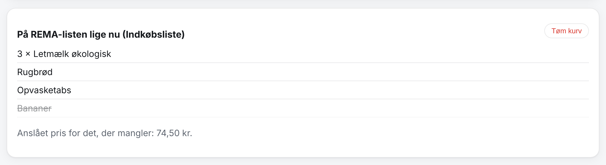

### Dine favoritvarer på tilbud

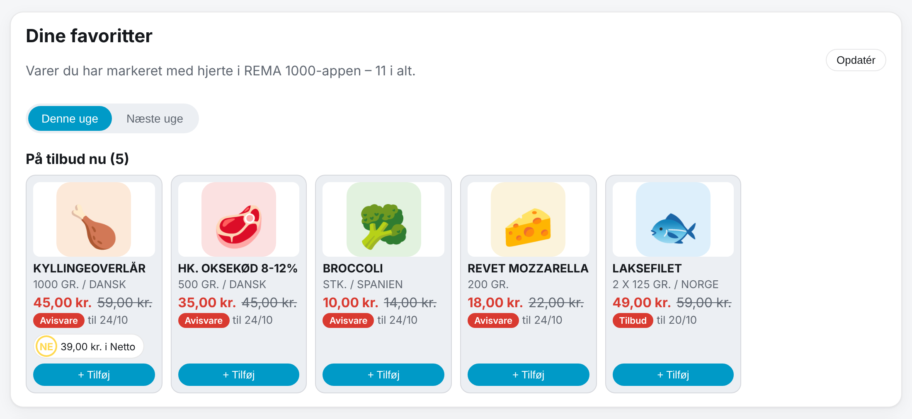

De varer, du har givet et hjerte i REMA 1000-appen. Vælg **Denne uge** eller **Næste uge** for at se, hvilke der er på tilbud, med før- og nu-pris, og læg dem på listen med ét tryk. Denne uge viser REMA's egne priser som i appen. Næste uge viser avisens priser og tekst, så snart den er ude, for REMA har dem først søndag kl. 02. Tilbud, der først gælder fra torsdag, vises med et blåt *fra tor*-mærke, indtil de starter. Er næste uges avis ikke udkommet endnu, vises denne uges tilbud. Alle favoritter kan filtreres.

Søg i REMA's varer nederst i *Favoritter* for at tilføje jeres egne favoritter ved siden af hjerterne fra appen.

**Overvågning.** Tryk på 🔔 på en favorit eller en hvilken som helst vare for at overvåge den – eller skriv noget, REMA ikke sælger, og overvåg det som tekst. Øverst i *Favoritter* ser du, hvor de overvågede varer er på tilbud: i REMA (nu eller fra næste uges avis) og i de kæder, du har valgt, med pris og en knap, der lægger varen i kurven eller på kædens indkøbsliste. Under **Indstillinger → Overvågning og beskeder** kan du få en besked på telefonen eller i Home Assistant, når noget fra overvågningslisten kommer på tilbud – og kun da. Listen tjekkes hver 3. time, og hvert tilbud nævnes én gang.

### Historik

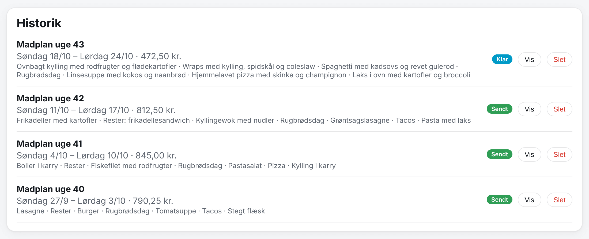

Tidligere madplaner med pris, status og retter. Åbn en gammel plan, og send den til REMA-listen igen, eller slet den.

### Familiens favoritretter og retter, I ikke kan lide

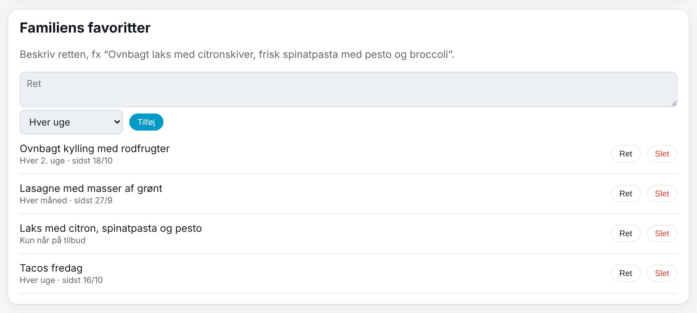

Beskriv de retter, familien elsker, og hvor tit de skal på planen (hver uge, hver 2. uge, hver måned, kun når ingredienserne er på tilbud eller bare til inspiration). Retter, I ikke kan lide, kommer aldrig på planen.

### Opskriftsamling – 👍, 👎 og ❤️

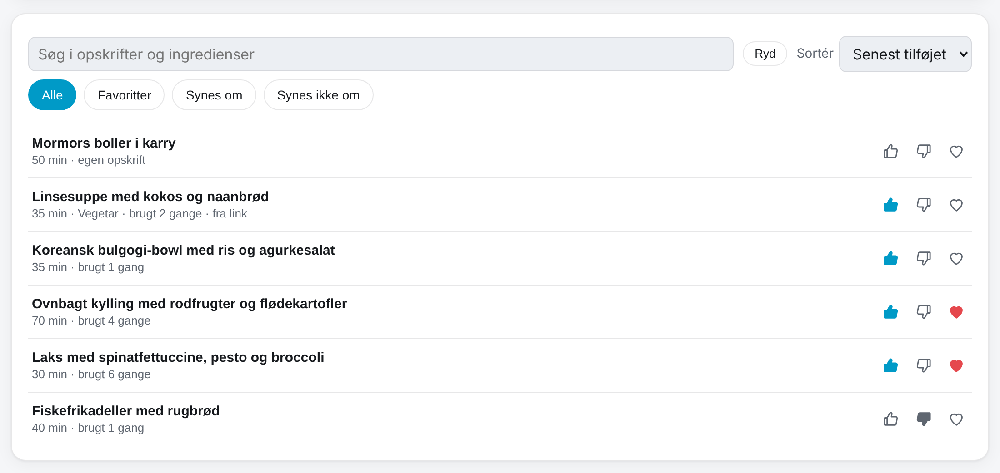

Fanen **Opskrifter** har tre sider: **Ugens opskrifter** som hidtil, **Opskriftsamling** og **REMA-opskrifter** (REMA 1000's egne opskrifter).

- **👍, 👎 og ❤️** på hver aftensmad i madplanen og på opskriften. 👍 gemmer retten i samlingen som en, I synes om, 👎 som en, I ikke synes om (den kommer aldrig på madplanen igen), og ❤️ som favorit (den får også 👍, og hjertet bliver rødt). Tryk igen for at fortryde; 👍 efter 👎 laver den om.
- **Søg, sortér og filtrér** i samlingen (navn, senest tilføjet, mest brugt, hurtigst; alle, favoritter, synes om, synes ikke om).
- **Tilføj en opskrift fra et link:** indsæt linket til en opskrift, og tryk på **Hent opskrift**. Opskriften læses fra siden (de fleste opskriftssider har den som data, ellers læser AI'en siden), og du kan rette den, før den gemmes. Selve linket gemmes ikke. Du kan også skrive en opskrift selv – skriv en ingrediens, og vælg en af REMA's varer til den, så indkøbslisten får præcis den vare.
- **Åbn en opskrift** for at rette navn, tider, ingredienser og trin, give den 👍, 👎 eller ❤️ eller **sætte den på madplanen** på en dag, du vælger – dens varer kommer på indkøbslisten.
- Nye madplaner og forslag til at skifte en ret bruger familiens favoritter og retter, I synes om, når de passer til ugens tilbud – og aldrig dem, I ikke synes om.
- **REMA 1000's opskrifter:** søg eller bladr i REMA's egne opskrifter – populære, nyeste, *Avisopskrifter* (bygget på ugens tilbud), *Aftensmad*, *Mad for børn*, *Kødfri* og flere. Hvert kort viser tid, en cirkapris og hvor mange af varerne, der er på tilbud. Hver ingrediens er koblet til en af REMA's varer, så indkøbslisten får præcis den vare. Gem en opskrift i samlingen (med billede), eller sæt den direkte på en dag i madplanen. I madplanen kan du trykke på en ret og vælge **Vælg en REMA-opskrift** for at skifte den ud med en af REMA's.

### Overrask os

Ved siden af **Lav ny madplan** på forsiden: en madplan med retter, familien aldrig har fået – fra andre køkkener, med spændende smage og overraskende kombinationer, men stadig inden for jeres budget, allergier, regler og tid på hverdage.

### Tilbud fra andre butikker

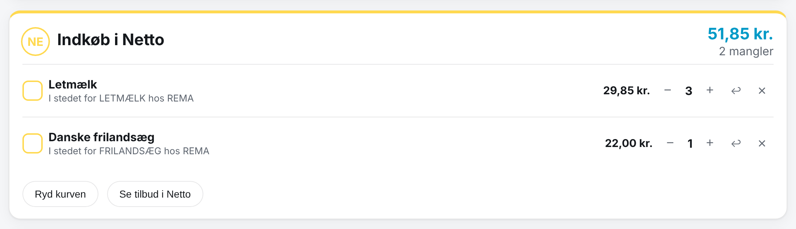

Middagsro handler stadig om REMA 1000, men under **Indstillinger → Andre butikker** kan I vælge andre kæder, I også handler i (Netto, Lidl, føtex, Bilka, 365discount, MENY, SuperBrugsen, Kvickly, Brugsen, SPAR, Løvbjerg, Min Købmand og ABC Lavpris).

- REMA 1000's logo står først: siden viser alle tilbud i REMA's avis.
- **Søg i alle butikker** under logoerne: en vares pris hos REMA og i de andre butikkers tilbud, pr. kilo, liter eller stk., med den billigste markeret – og sæt den på REMA-listen eller den billigere butiks liste.
- Deres **logoer vises i runde cirkler på forsiden**. Tryk på et for at se kædens madtilbud, søge i dem og lægge et på butikkens liste.
- I **indkøbslisten** viser et lille logo, når en vare er billigere i en af dem denne uge, og hvor meget I sparer. **Tryk på logoet** for at købe den der: varen flytter til en særskilt liste for butikken under REMA-listen og sendes ikke til REMA-appen. Hver butiksliste kan krydses af, mængder rettes, og varer slettes eller flyttes tilbage til REMA. **Ryd kurven** fjerner det, der er købt, og listen forsvinder, når den er tom.
- Under **Favoritter** viser det samme logo, hvilke af dine favoritvarer der er billigere andre steder den uge.
- Tilbuddene kommer fra kædernes egne tilbudsaviser på Tjek (eTilbudsavis), samme kilde som REMA's avis. En vare tæller kun som billigere, når det er samme slags vare (samme ord, fedtprocent og økologi eller ej), sammenlignet pr. kilo, liter eller stk.

### Indstillinger i undermenuer

Indstillingerne er delt op i sider – madplan og uge, familien, retter, indkøb, det AI'en skal huske, næring, andre butikker, Mealie og appen – hver med et kort overblik over, hvad der er valgt.

### Mealie

Er [Mealie](https://mealie.io) sat op i Home Assistant (den officielle Mealie-integration), kan madplanen arbejde sammen med den – slå det til under **Indstillinger → Mealie**:

- **Tag udgangspunkt i jeres egne opskrifter:** AI'en bruger familiens opskrifter i Mealie, når de passer til ugens tilbud og jeres regler, og finder selv på retter, når ingen passer. En ret fra Mealie beholder Mealies ingredienser og trin, og indkøbslisten følger dem. Når en ret udskiftes, foreslås jeres egne opskrifter også.
- **Gem en opskrift i Mealie:** *Gem i Mealie* på en opskrift fra madplanen gemmer den i Mealie med ingredienser, trin og tider.
- **Mealies kalender:** madplanens aftensmåltider kommer i Mealies madplan (som opskriften, når den findes i Mealie, ellers som en note) og opdateres, når en ret udskiftes eller slettes, eller en dag springes over.

Integrationen bruger Mealie-integrationens adresse og API-token, så intet skal skrives to gange.

### Lys og mørk tilstand

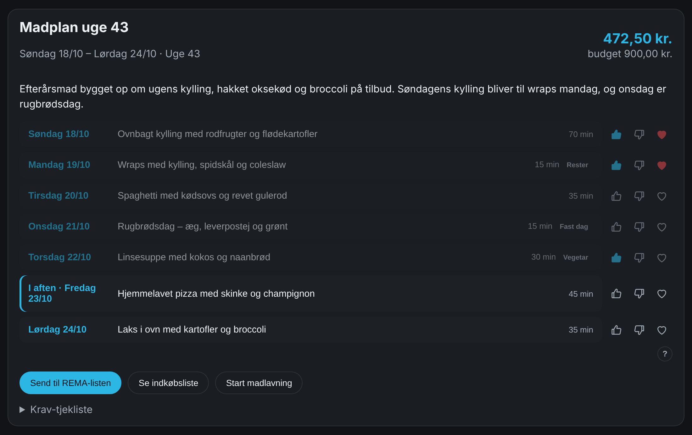

### App på hjemmeskærmen

Åbn `https://<din-home-assistant>/middagsro_app/app.html` i Safari eller Chrome, log ind og vælg **Del → Føj til hjemmeskærm**. Så åbner Middagsro i fuld skærm med sit ikon og dit Home Assistant-tema – også bag notch og hjemmebjælke. Træk ned for at opdatere. Linket står også under **Indstillinger** i panelet.

## Krav

- Home Assistant **2026.1** eller nyere.
- En REMA 1000-konto (samme login som på rema1000.dk og i REMA 1000-appen).
- Til madplanen: en **AI-opgave** i Home Assistant, fx fra Google Generative AI, OpenAI eller Anthropic (**Indstillinger → Enheder og tjenester → Tilføj integration**). Indkøbslisten, søgning, tilbud og favoritter virker uden AI.

## Installation

### Med HACS (anbefalet)

[](https://my.home-assistant.io/redirect/hacs_repository/?owner=Dinnsen&repository=ha-middagsro&category=integration)

1. Tryk på knappen ovenfor, eller gå til **HACS → ⋮ → Brugerdefinerede repositories**, og tilføj `https://github.com/Dinnsen/ha-middagsro` som **Integration**.
2. Søg efter **Middagsro** i HACS, og tryk **Download**.
3. Genstart Home Assistant.

### Manuelt

1. Hent kildekoden for den nyeste version under [Releases](https://github.com/Dinnsen/ha-middagsro/releases).
2. Kopiér mappen `custom_components/middagsro` til `config/custom_components/` i Home Assistant.
3. Genstart Home Assistant.

### Opdatering fra REMA 1000-integrationen (før 1.1.0)

Fra 1.1.0 hedder integrationens id og mappe `middagsro` (før: `rema1000`). Når du har opdateret i HACS og genstartet Home Assistant:

1. Gå til **Indstillinger → Enheder og tjenester → Tilføj integration**, og vælg **Middagsro**.
2. Den finder jeres REMA 1000-opsætning – tryk **Indsend**. Madplaner, indstillinger, opskriftsamling, enhed og entiteter flyttes med; entiteterne beholder deres id'er, og I skal ikke logge ind igen.
3. Slet den gamle mappe `config/custom_components/rema1000`, hvis HACS ikke har gjort det, og genstart én gang til.

Handlingerne hedder nu `middagsro.…` (før `rema1000.…`); ret dem i jeres automatiseringer og scripts. Appens gamle adresse på hjemmeskærmen virker stadig.

## Opsætning

[](https://my.home-assistant.io/redirect/config_flow_start/?domain=middagsro)

1. Gå til **Indstillinger → Enheder og tjenester → Tilføj integration**, og vælg **Middagsro**.
2. Log ind:

   | Felt | Beskrivelse |
   |---|---|
   | **E-mail** | Den e-mail, du logger ind på rema1000.dk og i REMA 1000-appen med. |
   | **Adgangskode** | Din REMA 1000-adgangskode. Den gemmes i Home Assistant og sendes kun til REMA 1000. |

3. Åbn **Middagsro** i sidebaren, gå til **Indstillinger**, og vælg familiens regler. Tryk så **Lav madplan**.

Integrationen logger selv ind igen, når sessionen udløber. Skifter du adgangskode, beder Home Assistant dig om den nye (**Indstillinger → Enheder og tjenester → Middagsro**). Vil du skifte e-mail eller adgangskode selv, så vælg **⋮ → Omkonfigurér** på integrationen. Du kan tilføje flere REMA 1000-konti. Hver får sine egne entiteter, og handlingerne kan rettes mod en bestemt konto; panelet viser den først tilføjede.

## Indstillinger i panelet

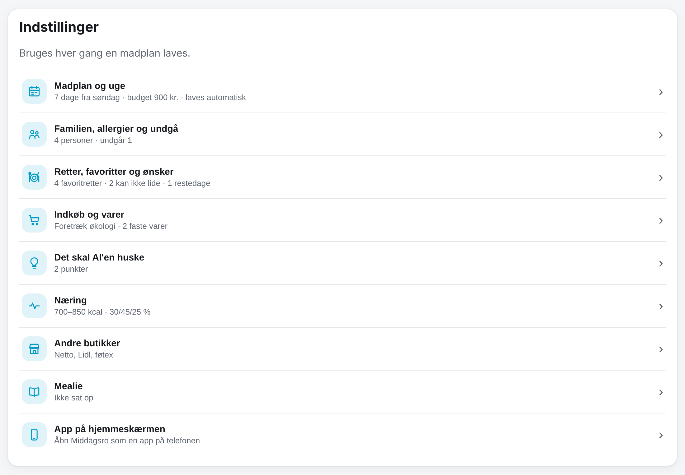

Indstillingerne gælder hver gang, en madplan laves, og gemmes pr. REMA 1000-konto.

| Indstilling | Hvad den gør | Standard |
|---|---|---|
| **AI-opgave-entitet** | Hvilken AI-opgave der laver planen. *Home Assistants standard* bruger den, der er valgt under AI-indstillingerne. | Standard |
| **Madplanen starter / der handles ind** | Ugedagen, planen starter på. Tilbudsavisen gælder fra søndag. | Søndag |
| **Antal dage** | 1–14 dage. | 7 |
| **Budget** | Hele indkøbslisten i kr. Over budget prøver AI'en én gang mere. | 500 |
| **Økologi** | *Udelukkende økologi*, *Foretræk økologi* (hvis højst x % dyrere end den billigste) eller *Ligeglad*. | Foretræk, 20 % |
| **Æg** | Skrabeæg, mindst frilandsæg eller kun økologiske æg. | Skrabeæg |
| **Mælk / frugt og grønt skal være økologisk** | Krav, der gælder uanset pris. | Fra |
| **Undgå** | Kød, svinekød, oksekød, fisk, skaldyr, animalske produkter (vegansk), stærk mad – og fritekst. | – |
| **Allergier** | De 14 allergener fra EU's liste (gluten, laktose, mælkeprotein, æg, nødder, jordnødder, soja, sesam, selleri, sennep, fisk, krebsdyr, bløddyr, lupin, sulfitter) – og fritekst. | – |
| **Familien** | Voksne og børn med alder og køn, så mængderne passer. | 2 voksne, 2 børn |
| **Vegetarretter** | Mindst og højst antal pr. plan. | 0–1 |
| **Restedage** | Dage, hvor der spises rester fra dagen før. | 2 |
| **Maks. minutter på hverdage** | Den tid, en ret højst må tage mandag–fredag. | 30 |
| **Ingen gentagelse** | Antal uger, før en ret må komme igen. | 3 |
| **Faste dage** | Fx *Rugbrødsdag* om onsdagen. | Torsdag: rugbrød |
| **Ønsker til maden** | Fritekst til AI'en. | Sund og børnevenlig |
| **Basisvarer** | Det, I altid har, og som ikke købes (salt, olie, mel …). | Salt, peber, olie m.m. |
| **Faste varer hver uge** | Søg i REMA's sortiment, og vælg en vare (eller skriv fritekst), som altid kommer på listen. | – |
| **Vi handler også sidst på ugen** | Nogle tilbud gælder først fra torsdag. Slået fra bruger madplanen kun tilbud, der gælder på indkøbsdagen. Slået til må de bruges i retter fra den dag; indkøbslisten deles i indkøbsdagen og torsdag, der sendes hver for sig. | Fra |
| **Automatik** | Lav næste uges plan automatisk, når den nye avis udkommer, og send den evt. til REMA-listen. Den sendes kl. 02 på indkøbsdagen (torsdagsvarerne kl. 02 torsdag), når REMA har ugens varer og priser. | Fra |
| **Familiens favoritter** | Retter med hyppighed. | – |
| **Retter familien ikke kan lide** | Kommer aldrig på planen. | – |

## Entiteter

Hver REMA 1000-konto bliver en tjeneste med disse entiteter:

| Entitet | Type | Beskrivelse |
|---|---|---|
| **Indkøbsliste** | `todo` | Din primære REMA-liste – den, der vises i appen. Tilføj, kryds af, ret antal og slet; ændringer vises i appen og omvendt. Det, du tilføjer (også via Assist), matches med en REMA-vare; skriv `3 x mælk` for 3 stk. Findes der ingen sikker vare, tilføjes det som tekst. |
| **Tilføj vare** | `text` | Skriv fx `letmælk`, `2 x rugbrød` eller `tre poser chips`. Varen matches og lægges på listen, og feltet tømmes bagefter. Attributterne viser, hvad der blev tilføjet. |
| **Madplan** | `sensor` | Status for madplanen (*Ingen plan*, *Laves*, *Klar*, *Sendt til indkøbsliste*, *Fejl*). Attributter: titel, start- og slutdato, pris, budget, over budget og aftensmaden pr. dag. |
| **Dagens ret** | `sensor` | Dagens aftensmad. Attributter: type, rester, portioner, tid, ingredienser, antal trin, tip og morgendagens ret. |
| **Indkøbsliste i alt** | `sensor` (kr.) | Anslået pris for det, der mangler at blive købt. Attributter: antal varer og varer uden pris. |
| **Aktuel tilbudsavis** / **Næste tilbudsavis** | `sensor` (tidspunkt) | Hvornår avisen gælder til / fra. Attributter: avisens navn, antal tilbud og hvornår integrationen første gang så næste uges avis. |
| **Madplan** | `calendar` | Hver dags aftensmad som en begivenhed med tid og ingredienser. |
| **Lav madplan** | `button` | Laver en ny plan med indstillingerne fra panelet. |
| **Send madplan til indkøbsliste** | `button` | Sender den nyeste plan til REMA-listen. |

## Handlinger

| Handling | Beskrivelse | Felter |
|---|---|---|
| `middagsro.search_products` | Søg i REMA 1000's sortiment med pris, tilbud og økologi. Giver et svar. | `query` (påkrævet), `limit` (1–100, standard 10), `config_entry_id` |
| `middagsro.get_offers` | Alle tilbud i den aktuelle eller næste tilbudsavis. Giver et svar. | `catalog` (`current` eller `upcoming`), `config_entry_id` |
| `middagsro.add_items` | Tilføj varer (REMA-varenummer eller fritekst) til REMA-listen. | `items` (påkrævet, liste med `product_id` eller `name` og evt. `amount`), `config_entry_id` |
| `middagsro.generate_meal_plan` | Lav en madplan i baggrunden. | `start_date`, `send` (send listen, når planen er klar), `config_entry_id` |
| `middagsro.send_meal_plan` | Send en madplans indkøbsliste til REMA-listen. | `plan_id` (tom = nyeste), `part` (`main` = indkøbsdagen, `late` = torsdagsvarerne, `all`; standard `main`), `config_entry_id` |

`config_entry_id` skal kun udfyldes, hvis du har flere REMA 1000-konti.

## Eksempler

**Tilføj varer fra en automatisering:**

```yaml
action: middagsro.add_items
data:
  items:
    - product_id: 20494
      amount: 2
    - name: Opvasketabs
```

**Søg efter en vare og brug svaret:**

```yaml
action: middagsro.search_products
data:
  query: letmælk
  limit: 5
response_variable: result
```

**Få besked, når næste uges tilbudsavis er ude:**

```yaml
triggers:
  - trigger: state
    entity_id: sensor.middagsro_naeste_tilbudsavis  # dit id for Næste tilbudsavis
    from: unknown
actions:
  - action: notify.mobile_app_din_telefon
    data:
      message: "Næste uges REMA-avis er ude – tid til en ny madplan."
```

**Lav og send madplanen lørdag morgen:**

```yaml
triggers:
  - trigger: time
    at: "08:00:00"
conditions:
  - condition: time
    weekday: sat
actions:
  - action: middagsro.generate_meal_plan
    data:
      send: true
```

**Med stemmen:** Sig *"Tilføj mælk til indkøbslisten"* til Assist (eller Siri via Home Assistant-appen), hvis **Indkøbsliste** er delt med Assist. Varen matches med en REMA-vare og vises i REMA 1000-appen.

**På et dashboard:** Vis **Dagens ret** i et felt-kort, **Indkøbsliste** i et to-do-kort og **Madplan**-kalenderen i et kalenderkort.

Entitets-id'erne afhænger af kontoens navn; find dem under **Indstillinger → Enheder og tjenester → Middagsro**. Installationer fra før 1.0.0 beholder deres `rema_1000_…`-id'er; nye får `middagsro_…`.

## Sådan virker det

- **Indkøbslisten** hentes fra REMA 1000 hvert **2. minut**, så ændringer i appen hurtigt ses i Home Assistant. Ændringer fra Home Assistant sendes med det samme.
- **Tilbudsaviserne** (aktuel og næste uge) hentes hvert **3. time** fra Tjek, som REMA 1000 bruger til sin avis.
- Madplanens priser er dem, der gælder på planens første dag, så en plan for næste uge bruger næste uges priser og tilbud. REMA's priser for en uge slutter før avisen gør; indtil ugen skifter søndag, gælder ugens priser stadig.
- **Madplanen** laves kun, når du beder om det (eller automatisk, når næste uges avis udkommer, hvis det er slået til). Den tager typisk 1–2 minutter: AI'en lægger planen, integrationen finder og prissætter varerne efter jeres regler, og til sidst skrives opskrifterne.
- Planer, indstillinger og favoritretter gemmes i Home Assistant og er med i backuppen.
- Mister integrationen forbindelsen til REMA 1000, bliver entiteterne utilgængelige og kommer igen af sig selv. Er login ugyldigt, beder Home Assistant dig om at logge ind igen.

## Kendte begrænsninger

- Kun REMA 1000 **Danmark** og kun din **primære** indkøbsliste (den, appen viser).
- Priserne er REMA's webpriser og kan afvige fra butikken. Tilbud uden for avisen (fx lokale tilbud i butikken) kendes ikke.
- Nogle ingredienser har ingen sikker REMA-vare (fx friske krydderurter). De kommer på listen som tekst og tæller ikke med i prisen.
- AI'en kan tage fejl. Tjek opskrifter og allergener, før I laver maden.
- Integrationen bruger ikke-offentlige kald og kan holde op med at virke, hvis REMA 1000 ændrer deres side.

## Fejlfinding

- **"Madplanen kunne ikke laves":** Tjek, at der er en AI-opgave i Home Assistant, og at den er valgt (eller at der er valgt en standard) under panelets **Indstillinger**. Mangler den, står der også en besked under **Indstillinger → Reparationer**. Svarer AI'en for langt eller ikke i det rigtige format, så prøv igen – eller vælg en anden model.
- **Login virker ikke:** Prøv at logge ind på rema1000.dk med samme e-mail og adgangskode. Brug **Omkonfigurér** på integrationen, hvis du har skiftet adgangskode.
- **Listen opdateres ikke i appen:** Træk ned i REMA 1000-appen for at opdatere. Home Assistant henter listen hvert 2. minut.
- **Panelet viser en gammel version efter en opdatering:** Genindlæs siden (på telefonen: luk og åbn appen).
- **Debug-log:** Gå til integrationen, og vælg **Aktivér debuglogning**. Gentag fejlen, og slå det fra igen for at hente loggen. Adgangskoden logges aldrig.
- **Diagnostik:** Vælg **⋮ → Hent diagnostik** på integrationen. E-mail, adgangskode, tokens og andre personlige oplysninger fjernes, før filen gemmes.

Opret gerne et [issue](https://github.com/Dinnsen/ha-middagsro/issues) med diagnostikfilen og en beskrivelse.

## Fjern integrationen

1. Gå til **Indstillinger → Enheder og tjenester → Middagsro**, vælg **⋮ → Slet** for hver konto. Panelet forsvinder, når den sidste konto er slettet. Din liste i REMA 1000-appen røres ikke.
2. Installeret med HACS: åbn **Middagsro** i HACS, og vælg **⋮ → Fjern**. Manuelt: slet mappen `config/custom_components/middagsro`.
3. Genstart Home Assistant.

## Privatliv

Dit REMA 1000-login gemmes i Home Assistant og sendes kun til REMA 1000. Til madplanen sender integrationen jeres indstillinger, ugens tilbud, jeres favoritretter, jeres ønsker til planen og de seneste ugers retter (så de ikke gentages) til den AI-tjeneste, du har valgt i Home Assistant – aldrig dit login eller din e-mail.

## Støt projektet

Kan du lide Middagsro, kan du [give mig en kop kaffe](https://buymeacoffee.com/dinnsen).

## Licens

[MIT](LICENSE) © Christian Dinnsen. REMA 1000 og REMA 1000-logoet tilhører REMA 1000. Integrationen er ikke lavet af eller godkendt af REMA 1000 eller de andre kæder; deres navne og logoer bruges kun til at vise deres tilbud.
